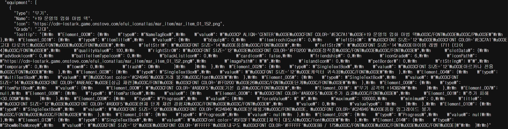

# 기획 의도

예전에 나는 아르카나라는 직업을 본캐로 키웠었다

아르카나라는 직업에 대해서 설명해보자면,

1. 아이덴디티인 '카드'가 랜덤으로 뽑힌다.
2. 이 '카드'에 따라서 딜 사이클을 유연하게 변경해야 했다.
3. 따라서 딜 편차가 꽤 심한 편이었고, 카드가 뽑힌 즉시 상황판단을 해야해서 초보와 고수의 격차가 극심했다.

이런 문제 때문에 인벤 아르카나 게시판에서는, 딜사이클을 점검할 때 단순히 두어번 돌려보는 다른 직업과 다르게 5분/10분, 심하게는 1시간 정도 루메루스(허수아비)를 쳐야지 내 기대 dps를 알 수 있었다.

정리하자면
- 내가 딜 사이클을 잘 굴리고 있는지 알기도 힘들고, 
- 내 기대 dps가 얼마나 되는지 알기 힘들었다.

그리고 한창 만들기 시작하게 될 때 즈음, 엘릭서와 초월이라는 색다른 스펙업 수단이 생겼다. 단순 장비레벨과 무기 강화수치로 얼추 캐릭터의 강함을 알 수 있는 시대를 넘어 이제 레벨만 보고서는 캐릭터가 얼마나 셀지 알 수 없었다.

더 나아가 커뮤니티에서 밸런스 토론을 할 때, "무슨무슨 직업이 지금 세다더라~" 하는 경험담으로만 구전되는데,이는 각 캐릭터의 스펙 상태에 따라, 그리고 경쟁 상대의 스펙 상대에 따라, 그리고 서폿 버프차이에 따라 체감하는게 너무 다를 수 밖에 없어서 명확한 지표를 삼을 수 있는 무언가가 있었으면 좋겠다고 생각했다.

그래서 내 캐릭터와 샘플 캐릭터의 예상 DPS를 도출해내는 시뮬레이터가 있으면 좋겠다고 생각했다.

# 유사 서비스 조사

AI로 서비스를 만들기 쉬워진 요즘, 경쟁 서비스나 K-RPG의 다른 서비스가 어떠한 방식을 채용했는지 생각해봤다.

생각해본것은 던전앤파이터의 '던담'과, 메이플스토리의 '환산주스탯'이었다.

'던담'는 특정 시간 내에 해당 스킬을 몇번 사용할 수 있는지 계산해서 스킬 데미지x사용 횟수를 모두 합산해서 계산하게 된다.
던전앤파이터라는 게임 특성상 스킬 간 연계가 적어서 스킬의 쿨타임이 돌아오는 대로 사용하기 때문에 합리적이라고 생각했다.

하지만 로스트아크의 경우에는 스킬간 연계가 매우 강하고, 랜덤 요소가 많아서 맞지 않는 방법이라고 생각했다. 앞서 생각해본 아르카나 뿐만 아니라, '예리한 둔기'와 같이 확률적으로 데미지가 감소하는 각인을 대중적으로 많은 캐릭터가 사용한다. 제일 중요한 포인트는 던전앤파이터는 모든 직업이 100%의 크리티컬 확률을 맞추는 것을 기본으로 한다는 것이다. 로스트아크는 캐릭터마다 치명타 확률이 모두 다르기 때문에 이에 따른 편차가 분명히 존재하게 되므로 기댓값과 편차가 더욱 커진다고 생각했다.

'환산주스탯'은 각 직업마다 딜 사이클을 잘 소화하는 사람의 딜 지분(전체 데미지에서 각 스킬의 지분이 얼마나 되는지)을 수집해서 사용자의 캐릭터가 딜을 해도 대표 딜 지분과 유사하게 나올것으로 가정하고 DPS가 얼마나 나올지 예측하는 방식을 사용한다.

이 또한 로스트아크는 연계 스킬이 많은 만큼, 단순 딜지분만으로 해당 캐릭터의 DPS를 예측하기 힘들다. 또한 로스트아크는 보석 차이에 따라서 스킬의 쿨타임이 크게 변하기 때문에 의미가 많이 퇴색된다고 생각했다. 예를들어 A라는 스킬은 변신 이후에만 사용할 수 있는데 변신을 하기 위한 스킬 쿨다운이 오지 않으면 쓰지 못해 심각한 딜누수가 발생할 수 있다.

위와 같은 방법은 커뮤니티에서 정형화된 데이터(지표)를 개인화 작업에 바로 적용할 수 있어서 비교적 쉽게 사용자 캐릭터의 유효한 지표를 산출할 수 있었지만, 로스트아크라는 게임에서는 불가능하다고 생각했다.

따라서 월드오브워크래프트의 'SimulationCraft'가 사용하는 몬테카를로 통계를 내는 방식이 제일 적합한 방식이라고 생각했다. 몬테카를로 방식은 진짜 시뮬레이터로 n번 돌려서 통계를 내는 방식이다. 무식하다면 무식하지만 직관적으로 결손치없는 통계를 뽑을 수 있는 장점이 있다.

# 초기 기술 Stack 선정

처음에 전체적인 아키텍처와 기술스택을 선정할 때, Raidbot 서비스를 참고했다. 참고로 SimulationCraft는 포터블한 시뮬레이터 자체를 의미하고, 웹에서 서버가 이 SimC를 돌리게 해주는 서비스가 Raidbot이다. 

필요한 기능을 생각해보자면

1. 전투정보실 처럼 내 캐릭터를 볼 수 있는 기능
2. 시뮬레이션을 하기 위해서 내 캐릭터를 커스터마이징할 수 있는 기능
3. 실제 서버에서 시뮬레이션을 돌리고 결과를 보는 기능

여기서 전투정보실 기능과 시뮬레이션 기능이 동일한 게임데이터를 참조하기 때문에, docker를 공부하면서 컨테이너를 기능에 맞춰 나누었다.
1. 시뮬레이션 컨테이너
2. 프론트엔드 컨테이너
3. 게임 데이터 컨테이너
4. FE에서 DB 컨테이너랑, 시뮬레이터 컨테이너를 단일 진입점으로 관리하기 위한 api-gateway 컨테이너

지금와서 회고해보자면 api-gateway 컨테이너는 오버엔지니어링이었다. MSA가 한창 대세일때라 직접 만들어보면서 감을 잡고 싶었기 때문에 MSA를 잘 몰라서 서비스에 맞지 않는 개념을 끼워넣은 느낌이었던것 같다. 애당초 api-gateway는 직접 만드는게 아니라, 잘 만들어진 자동화된 라이브러리를 사용하는게 맞았다. be에서 api endpoint를 하나 수정하면 api-gateway도 수정해야하니 일을 두번해야 했다. 잘 모르는 상태에서는 필요에 의해서 기술 레이어를 추가하는게 옳다는 것을 배웠다.

# 전투정보실 만들어보기

일단 캐릭터의 시뮬레이션을 돌리기 위해서는, 캐릭터 정보를 게임사에서 받아올 필요가 있었다.

근데 response가 순수 data가 아니라 이상한 형태로 되어있었다. 대충 읽어보니, 프론트에서 data를 그냥 삽입하면 되도록 response하고 있었다. 

기술적인 뭔가가 있는건 아니고 단순 노가다라서 여기서 시간이 오래 걸렸다. 다시 한번 모듈의 책임을 명확히 해야할 필요성과 api 서버를 짠다면, 데이터를 활용하는 개발자가 어떨지 생각해봐야 하지 않을까 다시 생각해보는 계기가 되었다.

# CRA -> Vite

나는 특히나 프론트개발을 할 일이 별로 없었기 때문에 예전에 인터넷강의에서 들었던 CRA - CreateReactApp을 사용해서 React 페이지를 짜고 있었는데, 서버에서 프론트엔드 빌드가 너무너무 오래걸려서 이상하다는 생각이 들었다. 그렇게 복잡한 사이트도 아닌데 5~10분이상 걸린다는게 말이 안된다고 생각했다.

구글링과 AI와 면담을 좀 해보니 요즘은 Vite라는 대체재를 주로 사용한다고 했다. Vite로 migration하니 build속도가 약 1/10 수준으로 줄어서 놀랐다.

CRA와 Vite는 **Build Tool**인데, 이름이 tool인것처럼 다양한 일을 한다. 사용자가 요청한 웹페이지를 조금이라도 빠르게 받기 위해서는, 그 웹페이지의 코드가 짧고 효율적이어야 한다. 그리고 server에 가하는 부하도 줄어든다.

그래서 build tool은 다음과 같은 작업을 한다:

1. import하고 안쓰는 module/export하고 안쓰는 function 정리
2. 실제 동작에 필요없는 괄호 제거 (괄호를 안써도 어짜피 우선도가 높은 경우라던가)
3. 개발자가 활용하기 용이하도록 길게 작성된 변수명/함수명을 짧게 축약
4. typescript로 작성된 코드를 javascript으로 변환 (ts으로 작성해도 실제로 돌아가는건 js다)
5. 여러 파일로 이루어진 코드들을 하나로 만들어서 보냄 (Bundling)

예전에 번들러에 대해서 공부했을때는 ~파일이 여러개면 각각 네트워크 비용이 들어서 비효율적이다~ 이렇게 이해했는데 생각해보니 병렬로 보내면 크게 문제되지는 않다는걸 알게 되었다.

TCP 연결이 제한되어있었던 구시대의 장점이지만, 여전히 코드를 효율화할 때 번들링을 하게 되면 중복된 부분을 크게 줄일 수 있는 장점이 남아있다.

빌드 자체가 빨라지는 이유는 CRA은 webpack을 쓰고, Vite는 esbuild+rollup을 사용하기 때문이다. webpack은 js기반이고, esbuild는 go기반이라 근본적인 속도차이가 크게 난다. 애초에 esbuild가 webpack의 느린 속도 문제 때문에 개발되었다.

Vite는 dev 레벨에서는 esbuild만을 사용해서 빌드속도가 매우 빠르고, prod 레벨에서는 안정성을 위해서 rollup을 사용하는데, esbuild로 의존성 번들링을 전처리 하고 rollup으로 최종 번들링을 하기 때문에 stable하지만 그래도 비교적 빠르게 빌드를 할 수 있게 된다.

이제 CRA는 2022년이후로 update가 없는 depreciated 상태이므로 사용하면 안된다.

# 시뮬레이터 엔진 만들기

본격적으로 메인 기능인 시뮬레이터를 만들자!

관성적으로 원래 웹서비스를 만들던 JS로 토대를 만들다가, 이런 생각이 났다.

> JS는 single thread으로 돌아갈텐데, 성능(속도)가 나올까?

특히 node.js는 io만 multi thread고 내부 로직은 single thread로 돌아가기 때문에 blocking 문제라도 해결하기 위해서 async/await을 쓴다고 네부캠에서 학습한 기억이 나서, 단순히 single thread으로 돌아가고 + 실행속도 자체도 느린 js으로 시뮬레이터가 커버될까 의문이 들었다.

마침 이번 프로젝트는 책임에 따라 module화를 잘 해놓은 덕분에 각 모듈마다 다른 언어를 선택할 수 있었다.

보통 성능이 필요한 작업에 사용되는 언어는 C++이다. 다만 전에 sdl2 + mingw 빌드환경 만들면서 쓸데없는 개고생을 한적이 있어서 뭔가 거부감이 들기도 했고, C++는 메모리 관리하기 힘들다는 단점이 있다고 생각해서 다른 선택지가 뭐가 있을까 고민하게 됬다. 결정적으로 C++에 그렇게 익숙하지 않아서, 이왕 배울거면 최근 유행하는 Go나 Rust와 같은 언어를 해보는것도 나쁘지 않겠다 싶었다.

# Simulator Stack 고민

c++의 역할을 주로 맡는 다음세대 언어로는 go와 rust가 있다고 들었는데, 이 둘의 특징과 장단점을 claude에게 물어가면서 비교했다.

go는 메모리 관리를 자체 gc가 대신해주고 배우기 쉬워 생산성이 높고, rust는 메모리 관리를 직접 관리하지만 안전하고, 소유권 등 생소한 개념이 많아서 입문하기 어렵다는 단점이 있다고 했다. go가 성능이 살짝 떨어지는 걸로 알고있지만 그리 큰 차이가 아니라고 생각했고, 생산성이 더 좋은 go를 대체로 추천해 go로 정하고 개발하기 시작했다.

# event stream에 기반한 iteration

대충 3분의 전투상황을 약 1만회 정도 반복하는 시뮬레이션을 해야하는 상황이라, 어떻게 하면 빠르게 시뮬레이션을 할 수 있을까 고민이 많았다. 