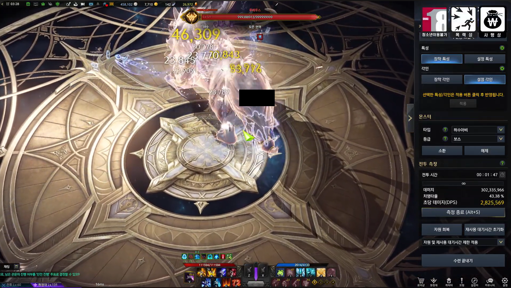
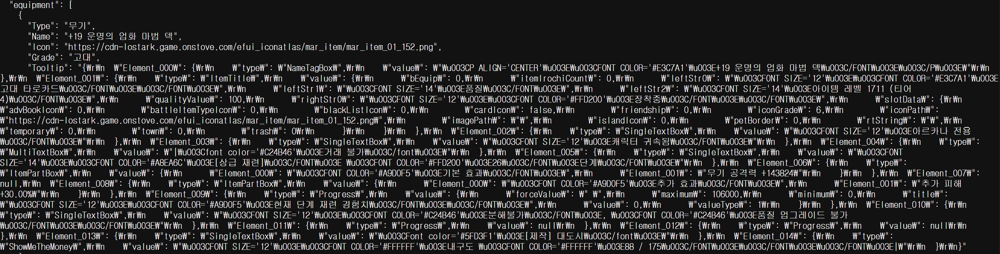

# 기획 의도

예전에 나는 아르카나라는 직업을 본캐로 키웠었다.

아르카나라는 직업에 대해서 설명해보자면,

1. 아이덴티티인 '카드'가 랜덤으로 뽑힌다.
2. 이 '카드'에 따라서 딜 사이클을 유연하게 변경해야 했다.
3. 따라서 딜 편차가 꽤 심한 편이었고, 카드가 뽑힌 즉시 상황판단을 해야해서 초보와 고수의 격차가 극심했다.

이런 문제 때문에 인벤 아르카나 게시판에서는, 딜 사이클을 점검할 때 단순히 두어번 돌려보는 다른 직업과 다르게 5분/10분, 심하게는 1시간 정도 루메루스(허수아비)를 쳐야지 내 기대 DPS를 알 수 있었다.

정리하자면,

- 내가 딜 사이클을 잘 굴리고 있는지 알기도 힘들고,
- 내 기대 DPS가 얼마나 되는지 알기 힘들었다.

그리고 한창 만들기 시작하게 될 때 즈음, 엘릭서와 초월이라는 색다른 스펙업 수단이 생겼다. 예전에는 장비레벨과 무기 강화수치를 보면 얼추 캐릭터의 강함을 알 수 있었는데, 이제는 레벨만 보고서는 캐릭터가 얼마나 셀지 알기 힘들었다.

더 나아가 커뮤니티에서 밸런스 토론을 할 때, "무슨무슨 직업이 지금 세다더라~" 하는 경험담이 자주 나왔다. 근데 내 캐릭터랑 상대 캐릭터의 스펙도 다르고, 그날 같이 간 서폿의 버프도 다르고, 레이드에서 실제로 딜을 할 수 있었던 시간도 다르다. 그러다보니 같은 직업을 보고도 체감하는게 너무 다를 수밖에 없어서, 조건을 맞춰놓고 비교할 수 있는 무언가가 있었으면 좋겠다고 생각했다.

그래서 내 캐릭터와 샘플 캐릭터의 예상 DPS를 도출해내는 시뮬레이터가 있으면 좋겠다고 생각했다.

# 유사 서비스 조사

AI로 서비스를 만들기 쉬워진 요즘, 경쟁 서비스나 K-RPG의 다른 서비스가 어떠한 방식을 채용했는지 생각해봤다.

생각해본 것은 던전앤파이터의 '던담'과, 메이플스토리의 '환산주스탯'이었다.

'던담'은 특정 시간 내에 해당 스킬을 몇번 사용할 수 있는지 계산해서 스킬 데미지 × 사용 횟수를 합산하는 방식이었다. 내가 생각하기에 던전앤파이터는 쿨타임이 돌아오는대로 스킬을 쓰는 상황이 많아서, 그렇게 사용 횟수를 계산하는게 합리적으로 보였다.

근데 로스트아크는 앞의 스킬이 어떻게 됐는지에 따라 뒤의 스킬을 쓸 수 있는지가 바뀌는 경우가 많다. 아르카나는 4스택을 쌓았을 때 루인기를 쓰고, 어떤 카드를 뽑았느냐에 따라 그 순서가 바뀐다. '예리한 둔기'처럼 확률적으로 데미지가 감소하는 각인도 있고, 캐릭터마다 치명타 확률이 달라서 같은 순서로 스킬을 써도 매번 데미지가 다르게 나온다.

'환산주스탯'을 보면서는 대표 딜 사이클의 딜 지분을 이용하는 방식을 생각해봤다. 딜 사이클을 잘 소화하는 사람이 어떤 스킬로 전체 데미지의 몇 %를 넣는지 알면, 사용자 캐릭터도 비슷한 비율로 딜을 넣는다고 가정해서 DPS를 예측할 수 있다.

이것도 로아에서는 보석 하나 바뀌었을 때 딜 지분이 그대로일지 애매했다. 예를 들어 A라는 스킬은 변신 이후에만 쓸 수 있는데, 게이지를 채우기 위한 스킬의 쿨타임이 늦어지면 변신 자체가 늦어진다. 그러면 그 시간 동안 A의 데미지가 조금 낮아지는 정도가 아니라, A를 한번 덜 쓰게 될 수도 있다.

그래서 월드오브워크래프트의 'SimulationCraft'가 사용하는 몬테카를로 방식이 제일 적합하다고 생각했다. 쉽게 말하면 진짜 전투를 n번 돌려서 통계를 내는 방식이다. 무식하다면 무식하지만, 같은 세팅으로 카드가 잘 나온 판과 안 나온 판이 얼마나 벌어지는지 볼 수 있다는 점이 마음에 들었다.

# 초기 기술 Stack 선정

처음에 전체적인 아키텍처와 기술스택을 선정할 때, Raidbots 서비스를 참고했다. 참고로 SimulationCraft는 시뮬레이터 자체를 의미하고, Raidbots는 웹에서 설정을 받아 서버에서 SimC를 돌려주는 서비스다.

필요한 기능을 생각해보자면,

1. 전투정보실처럼 내 캐릭터를 볼 수 있는 기능
2. 시뮬레이션을 하기 위해서 내 캐릭터를 커스터마이징할 수 있는 기능
3. 실제 서버에서 시뮬레이션을 돌리고 결과를 보는 기능

여기서 전투정보실 기능과 시뮬레이션 기능이 동일한 게임 데이터를 참조하기 때문에, Docker를 공부하면서 컨테이너를 기능에 맞춰 나누었다.

1. 시뮬레이션 컨테이너
2. 프론트엔드 컨테이너
3. 게임 데이터 컨테이너
4. 프론트엔드에서 게임 데이터랑 시뮬레이터에 단일 진입점으로 접근하기 위한 API Gateway 컨테이너

지금와서 회고해보자면 API Gateway 컨테이너는 오버엔지니어링이었다. MSA가 한창 대세일 때라 직접 만들어보면서 감을 잡고 싶었는데, 실제로 해보니 백엔드에서 API endpoint를 하나 수정하면 Gateway도 같이 수정해야 했다. API를 한 곳에서 받겠다고 코드를 한 겹 더 만들었더니, 나는 endpoint를 고칠 때마다 일을 두번 하고 있었다.

# 전투정보실 만들어보기

일단 캐릭터의 시뮬레이션을 돌리기 위해서는, 캐릭터 정보를 게임사에서 받아올 필요가 있었다.

근데 response가 내가 기대했던 순수 data 형태가 아니었다. 대충 읽어보니 프론트에서 툴팁을 그리기 편하도록 만들어진 데이터였다. 화면에 표시할 내용을 다시 헤쳐서 장비 효과나 스킬 설정처럼 시뮬레이터에 넣을 값을 뽑아야 했다.

기술적인 뭔가가 있는건 아니고 단순 노가다라서 여기서 시간이 오래 걸렸다. 내가 API 서버를 짠다면 데이터를 가져다 쓸 사람은 뭘 하고 싶을지, 화면에 보여줄 문장과 계산에 쓸 숫자를 어떤 형태로 줘야 편할지 다시 생각해보는 계기가 되었다.

# CRA에서 Vite로

나는 특히나 프론트 개발을 할 일이 별로 없었기 때문에 예전에 인터넷강의에서 들었던 CRA(Create React App)를 사용해서 React 페이지를 짜고 있었다. 근데 서버에서 프론트엔드 빌드가 너무너무 오래 걸려서 이상하다는 생각이 들었다. 그렇게 복잡한 사이트도 아닌데 5~10분 이상 걸린다는게 말이 안된다고 생각했다.

구글링과 AI와 면담을 좀 해보니 Vite라는 대체재가 있다고 했다. Vite로 migration하니 내 환경에서 빌드에 걸리는 시간이 약 1/10 수준으로 줄어서 놀랐다.

빌드할 때 하는 일을 대충 정리해보면,

1. import하고 안 쓰는 module이나 코드를 정리한다.
2. 실제 동작에 필요없는 공백이나 괄호를 정리한다.
3. 개발자가 읽기 좋게 길게 붙인 변수명이나 함수명을 줄인다.
4. TypeScript로 작성한 코드를 JavaScript로 변환한다.
5. 여러 파일로 나눠 작성한 코드를 브라우저에 보낼 묶음으로 만든다.

예전에 번들러에 대해서 공부했을 때는 ~파일이 여러개면 각각 네트워크 비용이 들어서 비효율적이다~ 정도로 이해했다. 근데 브라우저가 파일을 병렬로 받아올 수도 있고, 반대로 페이지 하나 열 때 당장 안 쓰는 코드까지 전부 한 파일에 묶어오면 그것도 느려질 수 있었다. 그때부터는 브라우저가 첫 화면을 그리려면 무슨 파일을 받아야 하는지에도 조금씩 관심을 가지게 됐다.

당시 내가 쓰던 CRA는 webpack을 사용했고, 옮겨간 Vite는 개발할 때 esbuild를 사용하고 배포용 번들을 만들 때 Rollup을 사용했다. 원래는 인터넷강의에서 본대로 도구를 골랐는데, 빌드가 바뀌는걸 직접 보고 나니까 내가 쓰는 도구가 뒤에서 뭘 하는지 찾아볼 이유가 생겼다.

# 시뮬레이터 엔진 만들기

본격적으로 메인 기능인 시뮬레이터를 만들자!

관성적으로 원래 웹서비스를 만들던 JS로 토대를 만들다가, 이런 생각이 났다.

> JS는 single thread로 돌아갈텐데, 성능이 나올까?

네부캠에서 Node.js를 배울 때 `async/await`으로 I/O를 기다리는 동안 다른 일을 할 수 있다는 얘기가 기억났다. 근데 이건 CPU가 계속 데미지랑 쿨타임을 계산하는 작업이라 `async/await`을 붙인다고 전투 여러 판이 알아서 병렬로 실행되는건 아니었다. JS도 Worker를 쓸 수 있지만, 이왕 시뮬레이터 모듈을 따로 만들어둔 김에 계산하는 부분은 다른 언어로 만들어보고 싶었다.

보통 성능이 필요한 작업에 사용되는 언어로는 C++이 먼저 떠올랐다. 다만 전에 SDL2랑 MinGW로 빌드환경 만들면서 쓸데없는 개고생을 한적이 있어서 뭔가 거부감이 들기도 했다. 결정적으로 C++에 그렇게 익숙하지 않아서, 이왕 배울거면 Go나 Rust 같은 언어를 해보는것도 나쁘지 않겠다 싶었다.

# Simulator Stack 고민

Go랑 Rust의 특징과 장단점을 Claude에게 물어가면서 비교했다.

Go는 메모리 관리를 자체 GC가 대신해주고 문법을 배우기 쉬워서, 일단 만들고 싶은게 있을 때 시작하기 편해보였다. Rust는 소유권이니 빌림이니 생소한 개념이 많았다. 아직 스킬을 어떤 자료구조로 잡을지도 모르는데 언어까지 새로 배우다가 지칠 것 같았다.

그때는 성능 차이가 얼마나 날지도 몰랐고, 우선 전투가 한번이라도 돌아가는 걸 보고 싶어서 Go로 정하고 개발하기 시작했다.

# event stream에 기반한 iteration

대충 3분의 전투상황을 약 1만회 정도 반복하는 시뮬레이션을 해야하는 상황이라, 어떻게 하면 빠르게 시뮬레이션을 할 수 있을까 고민이 많았다.

처음에 생각하기 쉬운 방법은 시간을 1ms씩 증가시키면서 지금 쓸 수 있는 스킬이 있는지, 맞아야 할 타격이 있는지 매번 확인하는 거였다. 근데 그렇게 하면 3분짜리 전투를 한번 돌리는데만 18만번을 확인해야 했다. 그 사이에 캐릭터가 그냥 다음 스킬 쿨타임을 기다리고 있는 시간도 꽤 길텐데, 그걸 전부 세고 있는게 좀 아까웠다.

그래서 일이 생기는 시간을 미리 큐에 넣어두기로 했다. 예를 들어 스킬을 누르고 300ms 뒤에 첫 타격이 들어오고, 200ms 뒤에 한번 더 맞는다면 300ms랑 500ms에 타격을 예약한다. 그 다음에 할 일이 900ms에 있으면 바로 거기로 넘어가면 된다. 타격이 들어오면서 게이지가 차서 카드를 뽑게 되면, 그때 손패를 보고 다음 행동을 다시 정하면 된다.

나중에는 같은 시간에 예약된 이벤트의 순서도 따로 고쳤다. 둘 다 500ms라고 해서 아무거나 먼저 꺼내면, 타격으로 생긴 효과를 뒤에 처리할 행동이 볼 수 있느냐가 달라진다. 처음에는 시간을 빨리 넘기려고 넣은 구조였는데, 만들어보니 내가 전투에서 어떤 일이 먼저 일어난다고 생각하는지가 그대로 드러나는 구조였다.

# 시뮬레이터를 서버에서 돌려야 할까?

처음에는 Raidbots처럼 서버에 시뮬레이터를 띄우고, 사용자가 버튼을 누르면 서버가 계산해서 결과를 보내주는 구조로 생각했다. Go로 만든 시뮬레이터를 Docker로 싸서 Cloud Run에 올리는 것도 생각해봤다. 아무도 안 쓸 때는 인스턴스가 내려가 있으니까 개인 프로젝트로도 감당할 만하다고 생각했다.

근데 내가 이걸 어떻게 쓸지 생각해보니까, 한번 돌려보고 끝낼 일이 별로 없었다. 보석 하나 바꾸고 한번, 트라이포드 바꾸고 한번, 카드 쓰는 조건 고치고 또 한번 돌려볼텐데, 버튼 누를 때마다 서버에서 3분짜리 전투를 몇천번씩 계산해줘야 했다. 쓰는 사람이 늘면 그 계산을 전부 내 서버에서 받아야 했다.

그러다 어차피 로아를 하는 사람은 게임 돌릴 수 있는 PC를 가지고 있을텐데, 그 PC에서 그냥 계산하면 되지 않을까 싶었다. 그래서 처음에는 **Go로 만든 엔진을 WASM으로 빌드**해서 브라우저에서 돌려봤다. 서버에서는 캐릭터 정보를 가져오고, 전투를 반복하는 일은 사용자 PC에서 하는 식이다. 브라우저에서는 Web Worker에 반복 횟수를 나눠주면 화면이 계산 끝날 때까지 멈춰있을 필요도 없었다.

물론 처음에 WASM 파일을 받아야 하고, 느린 노트북에서는 계산도 느릴 수 있었다. 서버에서 돌리면 어느 기기에서 접속해도 비슷한 속도를 낼 수 있었지만, 일단 PC에서 게임하다가 세팅을 바꿔보는 상황을 생각하면 브라우저에서 돌리는 쪽이 괜찮겠다고 생각했다.

# 이미 Go로 WASM을 돌리는데 왜 Rust로 바꿨나

Go로도 브라우저에서 병렬로 계산하는 것까지는 됐다. 근데 Worker를 여러 개 띄우면 각각 같은 캐릭터 정보를 받아서, 스킬 계수랑 트라이포드 같은걸 자기 쪽에서 다시 조립하고 있었다.

생각해보니 1만번의 전투에서 매번 달라져야 하는건 뽑힌 카드나 남은 마나, 스킬 쿨타임 같은 것들이었다. 시작할 때 정한 캐릭터의 특성이나 보석, 트라이포드는 어느 Worker가 계산하든 똑같았다. 그럼 캐릭터 설정은 처음에 한번만 계산해놓고, 각 Worker는 그걸 읽으면서 자기 전투 상태만 따로 들고 있으면 되지 않을까?

Rust로 옮길 때는 이 구조를 기준으로 다시 짰다. 스킬과 장비 효과를 적용한 캐릭터 프로필은 WASM 공유 메모리에 한번만 만들어두고, 각 Worker가 같은 프로필을 읽게 했다. 손패나 버프, 쿨타임은 매 전투마다 따로 만들었다. Rust로 짜면서 엔진 함수에도 프로필은 읽기 전용 참조로 넘기고, 전투 중에 바뀌는 상태만 수정할 수 있게 했다. 처음 언어를 고를 때는 Go가 만들기 편하냐, Rust가 더 빠르냐 정도로 생각했는데, 실제로 다시 짤 때는 **어떤 데이터를 한번만 만들고, 어떤 데이터는 매번 새로 만들어야 하냐**가 더 구체적인 기준이 됐다.

결과를 모으는 방식도 나눴다. 몇천번 돌릴 때는 피해량이나 시전 횟수 같은 숫자 위주로 모으고, 스킬을 몇 초에 썼는지 보고 싶을 때는 같은 엔진에 특정 seed를 넣어서 한 판을 자세히 다시 돌리는 식이다. 그 전에는 디버깅 로그를 찍는다고 매 회차마다 WASM에서 JS를 불렀는데, 한번 찍을 때는 티도 안 나는게 Worker마다 몇천번씩 쌓이니 그것도 꽤 큰 일이었다.

나눠서 계산하고 나니 합치는 쪽에서도 실수가 나왔다. 예를 들어 한 Worker가 4번 돌고 다른 Worker가 3번을 돌았는데, 두 Worker가 내놓은 평균을 그냥 더해서 2로 나누면 처음 4번과 나중 3번의 비중이 달라진다. 그래서 최종 평균은 각 회차의 DPS를 모아서 다시 계산하도록 고쳤다. 화면에서 seed를 바꿔도 Worker 쪽에서는 그 값이 빠져있던 문제도 이때 같이 고쳤다.

# 카드 뽑는 것까지 만들었는데, 카드를 언제 쓰지?

스킬이랑 카드를 하나씩 구현하고 나면 이제 아르카나를 돌릴 수 있을거라고 생각했다. 근데 내가 플레이할 때는 카드가 뽑히면 알아서 판단하던걸, 시뮬레이터에서는 전부 내가 써줘야 했다.

그래서 SimulationCraft에서 쓰는 APL(Action Priority List)처럼 행동에 우선순위와 조건을 달았다. 아르카나로 치면 ‘루인 스택이 4개면 레인을 쓴다’ 같은 내용을 적어놓는거다. 똑같은 순서로 스킬을 반복한다고 써두면 중간에 카드가 뽑혀도 하던대로 할테니, 그 시점에 가능한 행동 중에서 조건에 맞는 것을 고르게 했다.

예를 들어 황후 프리셋에서는 도태가 뽑혔을 때 심판도 손에 있고, 대상에게 루인 4스택이 쌓여있으면 도태를 쓰고 심판을 이어서 쓰게 했다. 여기까지만 보면 실제로 게임할 때 생각하던거랑 꽤 비슷했다. 근데 광대가 도태를 복사해서 손에 도태만 두 장이 되면 문제가 생겼다. 도태를 쓰려면 심판이 있어야 하는데, 두 칸 다 도태라서 심판이 들어올 자리가 없었다. 결국 같은 카드가 두 장이면 한 장을 쓰는 조건도 따로 넣었다.

이런걸 하나씩 넣고 나서야 결과에 찍힌 DPS가 ‘이 캐릭터의 스펙으로 내가 짠 우선순위를 따라갔을 때 나오는 DPS’라는게 와닿았다. 장비를 하나도 안 바꾸고도 카드 쓰는 조건이나 스킬 순서를 고치면 숫자가 움직였다. 처음에는 DPS 하나를 보고 싶어서 만들었는데, 나중에는 그 숫자가 왜 나왔는지 보려고 시전 순서랑 카드 사용 내역을 같이 보게 됐다.

# 스킬 데미지에 타수를 곱하면 되는 줄 알았다

엔진이 스킬을 순서대로 쓸 수 있게 되고 나니, 이번에는 스킬 하나가 실제로 뭘 하는지 알아내는 일이 길어졌다. 전투정보실 API로 캐릭터가 어떤 스킬과 트라이포드를 쓰는지는 가져올 수 있었다. 그 트라이포드를 찍으면 어떤 타격이 추가되고, 어느 타격에 데미지 증가가 붙는지는 툴팁이랑 게임 데이터를 따로 대조해야 했다.

셀레스티얼 레인이 기억에 남는게, 원본에는 반복 횟수처럼 보이는 칸에 `4`가 들어있었고 당시 구현은 첫 타격까지 세어서 5타로 처리했다. 그 다음에는 툴팁에 적힌 데미지가 5타 전체의 합인지, 한 타에 들어가는 데미지인지도 정해야 했다. 레인은 전체를 나눠서 넣고, 체크메이트처럼 같은 데미지를 반복해서 준다고 적힌 스킬은 타격마다 넣었다. 스트림 오브 엣지도 처음에는 레인처럼 나눴다가, 나중에 한 틱의 데미지로 보고 다시 고쳤다.

이걸 스킬마다 손으로 적기 시작하니까 ‘데미지를 올린다’, ‘타격을 하나 더 만든다’ 같은 동작을 원본에서 직접 읽어올 수 있으면 좋겠다고 생각했다. 그래서 레인을 가지고 기존에 손으로 만든 데이터 없이, 원본에서 스킬 동작과 투사체가 타격을 부르는 시간을 읽어서 다시 조립해봤다.

폭우 트라이포드를 넣은 한 조합에서는 기존 방식과 새 방식 둘 다 10타가 나왔고, 데미지 계수의 합도 같았다. 근데 첫 타격이 기존에는 약 242ms, 새로 조립한 쪽에서는 약 442ms에 들어왔다. 새 방식에서는 투사체에 붙어있던 200ms를 더했기 때문이다. 두 결과를 비교해서 알게 된건 원본에 있던 타이머를 적용하느냐에 따라 첫 타격이 0.2초 밀린다는 데까지였다. 실제 게임에서도 그 타이머를 같은 방식으로 쓰는지는 더 확인해야 했다. 그 사이에 카드 버프가 끝났다면 같은 10타라도 딜이 달라질 수 있으니, 시뮬레이터 입장에서는 꽤 큰 차이였다.

# 직업을 하나 더 넣는다는 것

아르카나를 만들고 나면 다음부터는 스킬이랑 트포 데이터만 바꿔 끼우면 될 줄 알았다. 스킬을 누르고, 타격이 들어가고, 쿨타임이 도는 부분은 실제로 재사용할 수 있었다. 근데 점화 소서리스 하나를 돌린다고 생각해보면, 해방 상태에서 종말의 날이 얼마나 세지는지 아는 것부터가 시작이었다. 게이지가 비어있는 상태에서 어떤 스킬로 얼마나 채우고, 언제 해방을 켜고, 해방이 끝나기 전에 어떤 스킬을 한번 더 넣을 수 있는지까지 정해야 3분짜리 딜 사이클이 나왔다.

슬레이어는 공개 수급량 표를 보면서 붙였는데, 스킬 이름이 같아도 표에서 측정한 트라이포드와 내가 돌리는 트라이포드의 타격이 다르면 그 숫자를 그대로 가져다 쓰기 어려웠다. 게이지가 9999에 멈추느냐, 이번 타격에 다 차서 바로 폭주하느냐에 따라 다음에 누르는 스킬이 달라졌다. 그래서 수급량을 확인하지 못한 일부 주력기는 폭주 중에만 쓰게 뒀다. 그렇게 하고 나니 적어도 어떤 조건에서 이 빌드가 돌아가는지는 설명할 수 있었다.

아크패시브랑 아크그리드는 또 다른 일이었다. 아크패시브 노드에 붙은 스킬 강화 효과를 찾으면 몇 포인트를 찍었을 때 그 단계가 켜지는지부터 확인해야 했다. 아크그리드는 코어 옵션에서 버프를 걸고, 그 버프가 다시 전투 효과를 불러서 특정 스킬에 적용되는 경우도 있었다. 그 경로를 찾아두면 어떤 스킬을 바꾸는지는 알 수 있는데, 실제 빌드에서 돌리려면 ‘버프가 걸린 동안 이 스킬을 맞혔을 때만’ 같은 조건도 구현해야 했다.

점화나 처단자는 대표 세팅을 하나씩 잡고 스킬, 트포, 아크패시브, 아크그리드를 같이 연결해봤다. 그러고 나서야 ‘이 직업 넣었다’고 한마디로 말하면 내가 어느 부분까지 만들었는지 전달이 잘 안된다는 걸 알았다. 스킬 하나를 따로 쳐볼 수 있는 것부터, 그 스킬에 코어를 끼우고 게이지를 채워가면서 3분짜리 사이클을 굴리는 것까지 사이에 할 일이 꽤 많았다.

# 어느정도 포기하게 된 이야기

처음에는 시뮬레이터 엔진만 만들어두면, 그 다음부터는 직업별로 스킬 데이터를 채워넣는 일이 남을거라고 생각했다. 근데 막상 해보니까 그 데이터를 만드는 일이 제일 오래 걸렸다.

스킬 하나를 넣으려면 기본 데미지랑 쿨타임을 적는 것부터 시작한다. 그 다음에는 트라이포드를 바꿨을 때 몇 타가 들어가는지, 어느 타격에 데미지 증가가 붙는지, 추가 타격은 몇 초 뒤에 들어가는지를 알아내야 했다. 원본에 숫자가 있어도 그게 타격 한 번에 들어가는 값인지, 스킬 전체에 적용되는 값인지 툴팁이랑 같이 봐야 했다. 레인 하나를 가지고도 타수랑 데미지를 맞춰놓고 나니까 이번에는 첫 타격 시간이 달랐다. 이런걸 직업마다 스킬마다 해야 했다.

근데 그렇게 스킬 데이터를 만들어도 마지막에 아덴 수급량이 남았다. 트라이포드가 아덴 수급량을 몇 % 올려주는지는 알아내도, 정작 그 스킬을 맞혔을 때 기본으로 얼마나 차는지 모르는 경우가 있었다. 커뮤니티에서 측정한 표를 찾기도 했는데, 내가 넣으려는 트라이포드랑 타격 구성이 다르면 그 숫자를 그대로 쓰기 어려웠다. 표에 없는 세팅까지 넣으려면 결국 조건을 맞춰놓고 하나씩 다시 재야 했다.

예를 들어 점화 소서리스가 이번 스킬로 아덴을 다 채우면 바로 해방을 켤 수 있다. 근데 실제로는 조금 모자라서 스킬을 하나 더 써야 하는 상황이라면, 해방을 켜는 시간부터 밀린다. 그러면 해방 안에 주력기를 몇 번 넣는지도 달라진다. 아르카나도 게이지가 언제 차느냐에 따라 루인기를 쓰기 전에 카드 한 장을 더 뽑을 수도 있고, 그 카드 때문에 다음에 누르는 스킬이 바뀔 수도 있다.

대충이라도 수급량을 넣으면 시뮬레이터는 돌아갔다. 1만번 돌리면 평균 DPS도 소수점까지 나왔다. 근데 그 1만번 모두 내가 넣어둔 수급량으로 게이지를 채운다. 수급량이 틀렸으면 해방을 켜는 시간이나 카드를 뽑는 타이밍도 매번 그 값의 영향을 받는다. 처음에는 많이 돌리면 믿을 만한 숫자가 나올거라고 생각했는데, 아무리 많이 돌려도 내가 모르는 수급량을 알아낼 수는 없었다.

그래서 전투정보실에서 아무 캐릭터나 가져와도 그 캐릭터의 기대 DPS를 알려주겠다는 목표는 어느정도 포기했다. 스킬 데이터를 만드는 데부터 손이 너무 많이 갔고, 그걸 다 채워도 아덴 수급량을 확인할 수 없는 세팅에 대해서는 결과가 정확하다고 말하기 어려웠다. 지금은 수급량 근거를 확보한 샘플 위주로 돌려볼 수 있게 두고, 그 세팅에서는 아덴이 언제 찼고 그 뒤에 어떤 스킬을 썼는지까지 볼 수 있는 정도로 남겨뒀다.